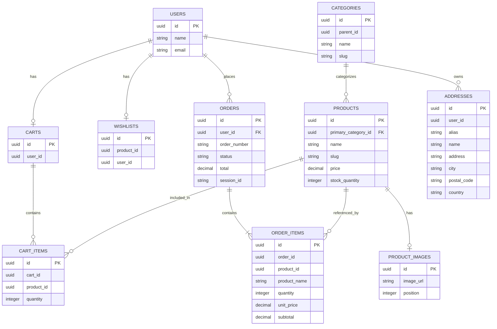

# Database Structure

## Entity Relationship Diagram

## Main Relationships

- A user can have a cart.
- A cart contains multiple cart items.
- Products can belong to categories.
- An order contains multiple order items.
- An order can belong to a registered user.
- A user can wishlist items.